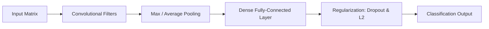

<p align="center">
  
</p>

<p align="center">
    
</p>


## 📌 Table of Contents
- [📖 Executive Summary](#-executive-summary)
- [✨ Key Features & Capabilities](#-key-features--capabilities)
- [🏗️ System Architecture & Workflow](#️-system-architecture--workflow)
- [🛠️ Tech Stack Breakdown](#️-tech-stack-breakdown)
- [⚙️ Reproducible Quickstart & Setup](#️-reproducible-quickstart--setup)
- [📂 Project Directory Layout](#-project-directory-layout)
- [👩‍💻 Author & Contributions](#-author--contributions)

---

## 📖 Executive Summary
### Problem Statement
Understanding internal neural representations requires dissecting forward propagation math, convolution kernels, pooling mechanisms, and empirical regularization techniques.

### Motivation & Solution Overview
Comprehensive deep learning experimental laboratory containing theoretical reports, forward propagation notebooks, CNN layer visualizations, and bias-variance tradeoff studies.

---

## ✨ Key Features & Capabilities
- **Forward Propagation:** Matrix algebra implementations of forward passes in multi-layer perceptrons.
- **Convolution & Pooling:** Kernel transformations, feature map extractions, and spatial pooling.
- **Overfitting & Underfitting Analysis:** Regularization strategies, dropout, and early stopping explorations.
- **Ethics in AI:** Detailed analytical reports on ethical considerations in deep neural network deployments.

---

## 🏗️ System Architecture & Workflow


---

## 🛠️ Tech Stack Breakdown
| Category | Technologies |
|---|---|
| **Core Libraries** | TensorFlow, Keras, NumPy, Matplotlib |
| **Environments** | Jupyter Notebook, Python 3.10 |
| **Coursework Reference** | Alliance University Department of Computer Applications |

---

## ⚙️ Reproducible Quickstart & Setup
### Quickstart
```bash
git clone https://github.com/Bhumikaravi/Deep-learning.git
cd Deep-learning
pip install tensorflow numpy matplotlib jupyter
jupyter notebook
```

---

## 📂 Project Directory Layout
```text
Deep-learning/
├── Ethical_Considerations_in_Deep_Learning_B.docx
├── Project_10_Overfitting_Underfitting_Analysis (1).ipynb
├── Project_12_Convolution_and_Pooling (1).ipynb
├── Project_5_DL.ipynb
├── Project_6_Neural_Network_Forward_Propagation (1).ipynb
└── README.md
```

---

## 👩‍💻 Author & Contributions
Developed by **Bhumika Ravi** ([@Bhumikaravi](https://github.com/Bhumikaravi)), Bachelor of Computer Applications (BCA) at **Alliance University, Bengaluru**.

- 💻 **GitHub Profile:** [github.com/Bhumikaravi](https://github.com/Bhumikaravi)
- 🔗 **LinkedIn:** [linkedin.com/in/bhumika-ravi-b5a01b326](https://www.linkedin.com/in/bhumika-ravi-b5a01b326/)
- 📬 **Email Contact:** [bhumikaravi2006@gmail.com](mailto:bhumikaravi2006@gmail.com)

---

<p align="center">
  
</p>
